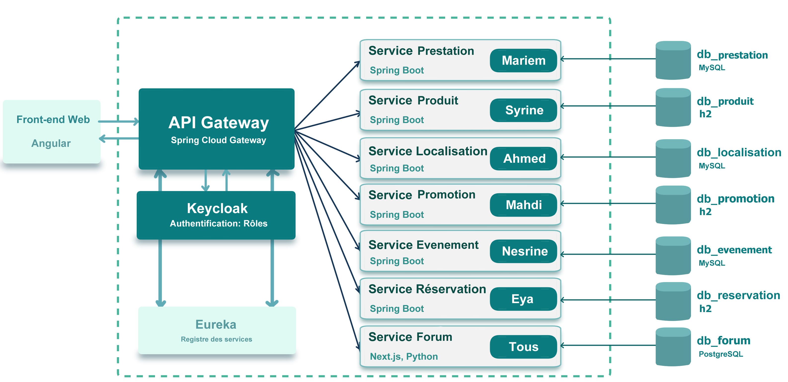

# 9arrabi

9arrabi est une application web qui facilite la recherche de produits et de services locaux. Elle repose sur une architecture en microservices.

## Services

| Service      | Description                                                               | Membre |
|--------------|---------------------------------------------------------------------------|---|
| Prestation   | Publication et consultation des services et offerte des devis             | Mariem |
| Produit      | Publication et consultation des produits et les commander                 | Syrine |
| Localisation | Adresses et recherche d'offres à proximité                                | Ahmed |
| Promotion    | Création des promotions et codes promo pour les services et les produits. | Mahdi |
| Evenement    | Publication, consultation et participation à des événements.              | Nesrine |
| Réservation  | Créneaux et réservations des services                                     | Eya |
| Forum        | Espace d'échange pour les utilisateurs.                                   | Tous |

## Architecture

## Technologies

- Back-end : Spring Boot, MySQL
- Dashboard : Python, PostgreSQL, Next.js
- Front-end : Angular, Bootstrap
- Documentation API : Springdoc OpenAPI (Swagger UI)
- Déploiement : Docker, Docker Compose

## Lancement

Prérequis : IntelliJ

## Accès

| Composant | URL |
|---|---|
| Front-end (Angular) | http://localhost:4200 |
| API Gateway | http://localhost:8080 |
| Dashboard | http://localhost:3000 |
